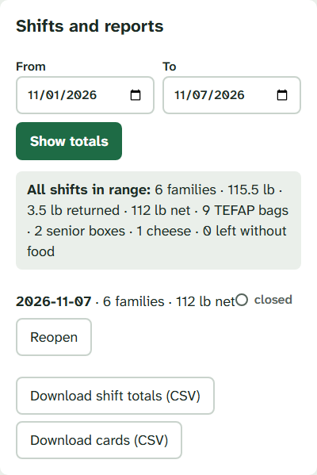
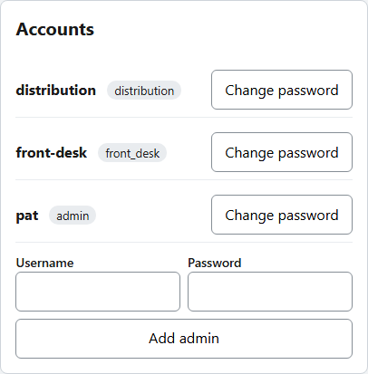
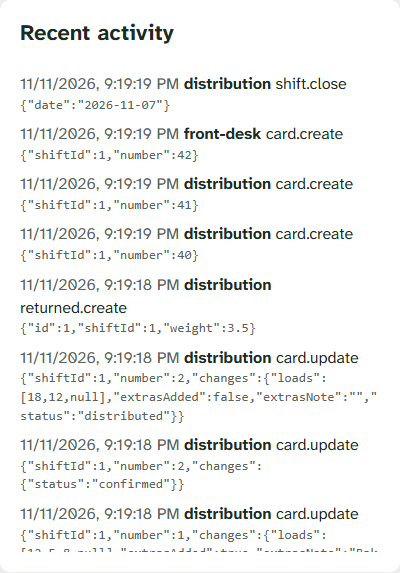

# Admin guide
**Version 1.1.0** · Food bank shift tracker · 2026-11-11 · For food bank staff

---

## AI READING INSTRUCTION

Read `[SPEC]` and `[BUG]` blocks for the steps staff follow and the problems they may meet.
Read `[NOTE]` only if the reason behind a step is needed.
`[?]` blocks are unverified.

---

## 1. Staff sign-in

**[SPEC]**
- Each staff member has their own admin sign-in. It lasts 12 hours.
- Admins can use every screen: **Front desk**, **Distribution**, **Totals**, **Admin** and **Help**.

**[NOTE]**
Station sign-ins are shared, so the app records changes by station, not by person. Admin changes are recorded by name.

---

## 2. Shifts and reports

**[SPEC]**
- Open **Admin**, choose the **From** and **To** dates, then tap **Show totals**.
- The first line gives the totals for every shift in that range.
- Each shift is listed with its families and net weight.
- **Reopen** a closed shift to correct it, then **Close** it again.

**[SPEC]**
- **Download shift totals (CSV)**: one row per shift, for a spreadsheet.
- **Download cards (CSV)**: one row per card, including Door Dash and Helping Hands Families. Among its columns:
  - `cart_1`, `cart_2`, `cart_3`: the weight of each cart, in pounds;
  - `extras_added` and `extras_note`: whether extras were ticked, and what was added;
  - `intake_initials`: the initials of the intake volunteer the details came from. Door Dash and Helping Hands cards have none.

**[NOTE]**
The cart columns were called `load_1` to `load_3` before 2026-11-11. A spreadsheet built on the old names needs updating.

**[NOTE]**
A reopened shift does not close by itself overnight. Remember to close it once the correction is made.

---

## 3. Correcting cards

**[SPEC]**
- **Delete** a card entered by mistake, such as a duplicate or a typo. It appears on each card in the **Front desk** list, and in the closing warning on **Distribution**.
- Deleting asks for confirmation, needs a connection, and only works while the shift is open.
- Every station loses the card straight away. **Recent activity** keeps a record of what it held.
- For a Family who left before being served, record **Left without food** from the closing warning on **Distribution** instead. That keeps the card and counts the Family separately.

**[NOTE]**
Deleting cannot be undone. When in doubt, record the Family as left without food, which can be undone.

---

## 4. Accounts

**[SPEC]**
- **Change password** for a station or an admin. Changing a station's password signs that station out on every device.
- **Add admin** to give another staff member their own sign-in.
- **Remove** an admin who no longer needs access. You cannot remove yourself.

**[BUG] A station password may have been shared outside the food bank**
Symptom: Someone outside the food bank knows a station password.
Cause: The password was written down or passed on.
Fix: Change that station's password at once, then sign the station devices in again with the new password.

---

## 5. Recent activity

**[SPEC]**
- **Recent activity** lists recent changes: which station or admin made them, and when.

---

## 6. When things go wrong

**[SPEC]**
- If the app is down for more than a few minutes during a shift, switch to the paper sheets.
- After the shift, enter the paper records in the app, then close the shift.
- Tell the person who looks after the app.
