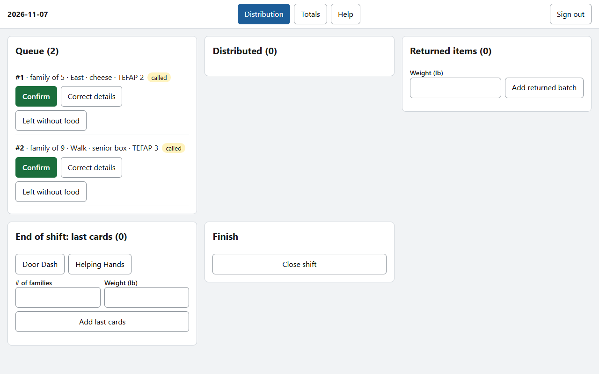
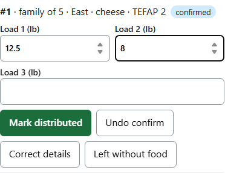
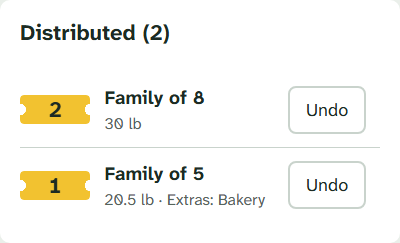
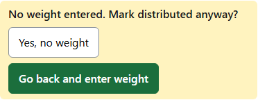
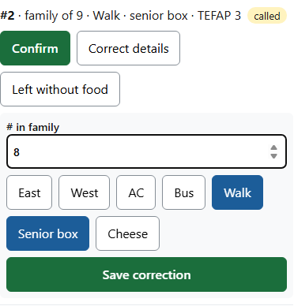
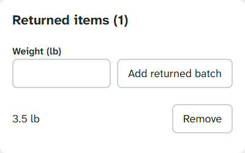
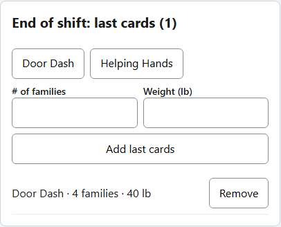
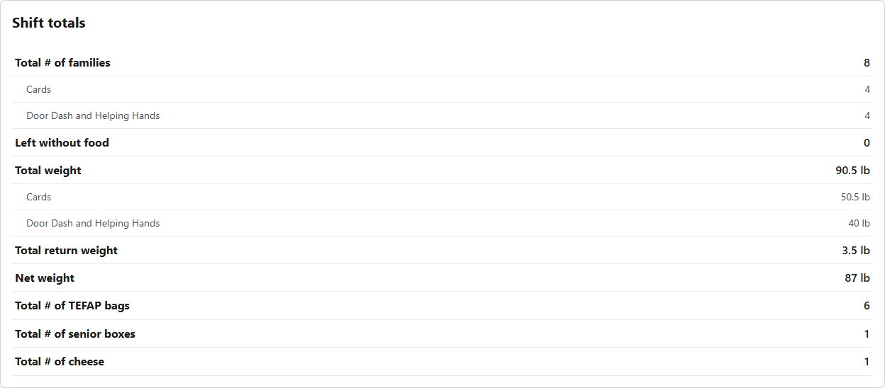
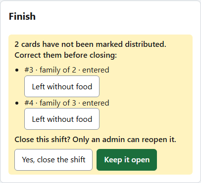
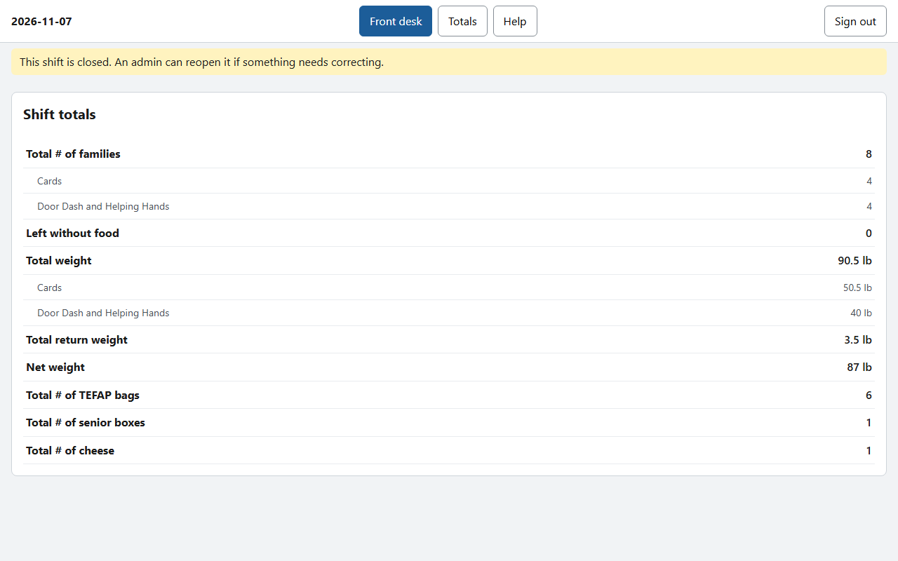

# Distribution guide
**Version 1.0.0** · Food bank shift tracker · 2026-11-08 · For distribution volunteers

---

## AI READING INSTRUCTION

Read `[SPEC]` and `[BUG]` blocks for the steps a volunteer follows and the problems they may meet.
Read `[NOTE]` only if the reason behind a step is needed.
`[?]` blocks are unverified.

---

## 1. Your screen

**[SPEC]**
- **Queue**: families called forward by the front desk, with their details.
- **Distributed**: families served today, with the weight they received.
- **Returned items**, **End of shift: last cards** and **Finish** are further along.

**[NOTE]**
You never type a family's details. They arrive from the front desk.

---

## 2. Serving a family

**[SPEC]**
1. When the family arrives, tap **Confirm** on their card.
2. Enter the weight of each load: **Load 1**, **Load 2**, **Load 3**. Use only as many as you need. They are added up for you.
3. Tap **Mark distributed**.

**[SPEC]**
- The family moves to **Distributed**, with their total weight.
- Tapped by mistake? **Undo confirm** takes a confirmed card back. **Undo** on a distributed card takes it back to confirmed.

**[BUG] The app asks "No weight entered. Mark distributed anyway?"**
Symptom: A yellow box asks whether to mark the family distributed with no weight.
Cause: No load weight was entered.
Fix: Tap **Go back and enter weight** and enter the weights. Only choose **Yes, no weight** if the food truly was not weighed. The totals will then show that a card has no weight.

---

## 3. Correcting a card

**[SPEC]**
- If the family size, arrival method, senior box or cheese is wrong, tap **Correct details**.
- Make the change, then tap **Save correction**.
- TEFAP bags are worked out again. The front desk sees the change straight away.

---

## 4. A family who leaves without food

**[SPEC]**
- If a family leaves before being served, tap **Left without food** on their card, then **Yes, left without food**.
- The card leaves the queue and moves to the **Distributed** list, marked **left without food**.
- The family is not counted as served. Totals show them on their own line, **Left without food**.
- Recorded by mistake? Tap **Back to queue** on that card.

**[NOTE]**
Only distribution and staff can record this. A card entered by mistake, such as a duplicate, is different: ask staff to delete it.

---

## 5. Returned items

**[SPEC]**
- When items come back, enter their weight under **Returned items** and tap **Add returned batch**.
- Each batch is separate. Returned items are not tied to any card.
- Entered by mistake? Tap **Remove** next to it.

---

## 6. End of shift: Door Dash and Helping Hands

**[SPEC]**
- At the end of the shift, enter each partner's batch under **End of shift: last cards**.
- Tap **Door Dash** or **Helping Hands**, enter the number of families and the weight, then tap **Add last cards**.
- These are never mixed into the queue.

---

## 7. Totals

**[SPEC]**
- Tap **Totals** at the top to see the shift totals.

| Total | How it is worked out |
|---|---|
| Total # of families | Cards entered, plus Door Dash and Helping Hands families. Families who left without food are not included |
| Left without food | Cards recorded as leaving without food |
| Total weight | Card loads, plus Door Dash and Helping Hands weight |
| Total return weight | All returned batches |
| Net weight | Total weight minus return weight |
| TEFAP bags, senior boxes, cheese | Counted from the cards of families served |

**[NOTE]**
A card entered at the front desk counts as a family even before it is distributed. By the end of the shift, every card should be either distributed or recorded as left without food.

---

## 8. Closing the shift

**[SPEC]**
- When the last family is served and every batch is entered, tap **Close shift** under **Finish**.
- If any card has not been distributed, the app lists it. Correct each one before closing:
  - the family was served: go back to the queue and finish their card;
  - the family left: tap **Left without food**;
  - the card was entered by mistake: staff can **Delete** it.
- Then tap **Yes, close the shift**.
- Both stations lock and show the final totals.
- Only staff can reopen a closed shift.
- A shift left open closes by itself overnight.

**[BUG] Something needs fixing after the shift was closed**
Symptom: The screens say **This shift is closed**, and nothing can be changed.
Cause: The shift was closed.
Fix: Ask staff to reopen it from the Admin screen. Make the correction, then close it again.
