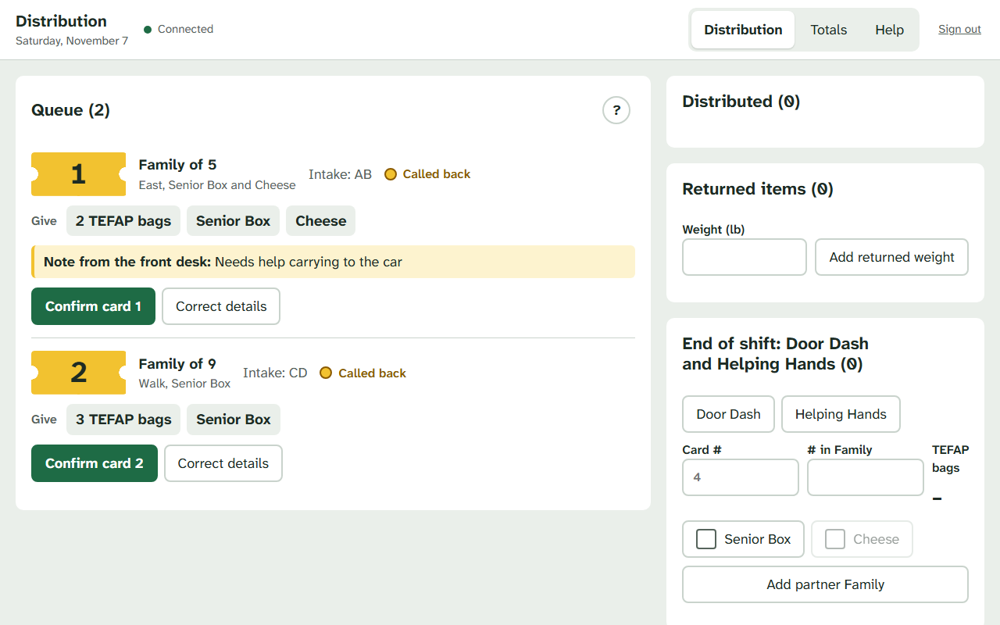
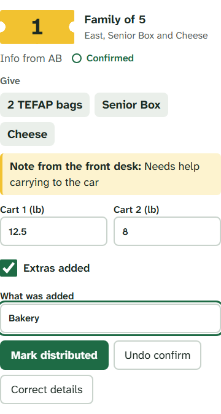
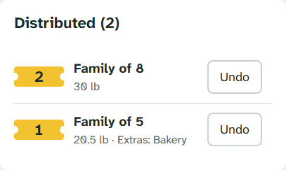
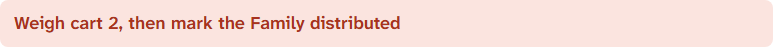
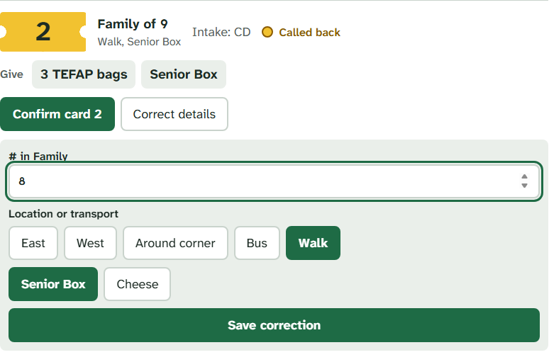
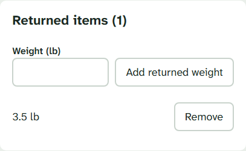
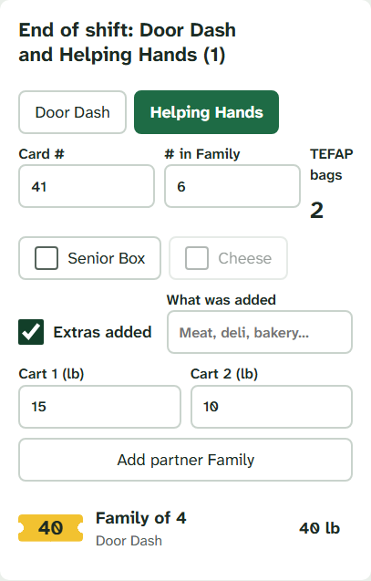
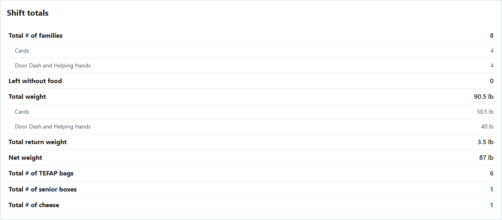
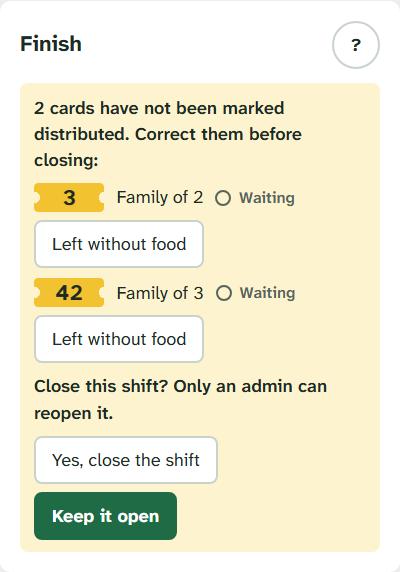
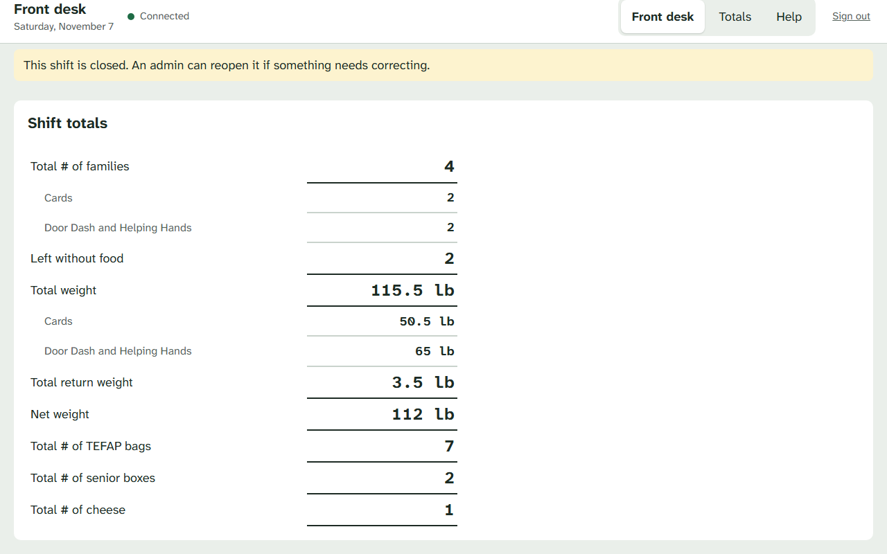

# Distribution guide
**Version 1.5.0** · Food bank shift tracker · 2026-11-26 · For distribution volunteers

---

## AI READING INSTRUCTION

Read `[SPEC]` and `[BUG]` blocks for the steps a volunteer follows and the problems they may meet.
Read `[NOTE]` only if the reason behind a step is needed.
`[?]` blocks are unverified.

---

## 1. Your screen

**[SPEC]**
- **Queue**: Families called back by the front desk, with their details and any note from the front desk. They are listed in the order they were called, so the family at the top has been waiting longest. A family whose call is undone and called again goes to the bottom.
- Each card leads with the Family's yellow ticket number, then **Intake:** with the initials of the intake operator who typed in the details, then a **Give** line listing the TEFAP bags, Senior Box and Cheese to hand over.
- **Distributed**: Families served today, with the weight they received and any extras added.
- **Returned items**, **End of shift: Door Dash and Helping Hands** and **Finish** are beside the queue on a wide screen, or below it on a smaller one.

**[SPEC]**
- If the distribution room has a wall display, it shows the same queue in large type. **Confirmed** lists the Families being packed and **Called** lists the Families on their way, each with the yellow ticket number, the Family size, the carts and any Senior Box or Cheese, in the order they were called.
- It shows no initials, notes or weights. Use the tablet for those, and to change anything.
- When the list is longer than the screen, the last line says how many more are waiting. The Families who have waited longest are always shown.
- If the screen says **Not connected**, the queue is hidden on purpose, because it may be out of date. Use the tablet until the queue comes back, and tell the maintainer if it stays.

**[NOTE]**
You never type a walk-in Family's details. They arrive from the front desk. Only Door Dash and Helping Hands Families are entered here, at the end of the shift.

---

## 2. Serving a Family

**[SPEC]**
1. When the front desk calls a card back, check its number and details against the call, then tap **Confirm card** with its number, for example **Confirm card 16**. The front desk sees the card confirmed.
2. Enter the weight of each cart: **Cart 1 (lb)**, and **Cart 2 (lb)** and **Cart 3 (lb)** if shown. Every cart needs a weight above 0 before the Family can be marked distributed. The card shows one cart for each TEFAP bag. They are added up for you. <!-- help:serving -->
3. For a Family of 5 to 7, 9 to 11, or 13 or more, tick **Extras added** once you have added the extras. Under **What was added**, you can note what they were, for example meat, deli or bakery. The note is optional. <!-- help:serving -->
4. Tap **Mark distributed**.

A note from the front desk, if there is one, appears in yellow under the card's details.

**[SPEC]**
- The number of carts follows the Family size:

| People in Family | Carts |
|---|---|
| 1 to 4 | 1 |
| 5 to 8 | 2 |
| 9 or more | 3 |

**[SPEC]**
- The Family moves to **Distributed**, with their total weight and any extras added.
- Tapped by mistake? **Undo confirm** takes a confirmed card back. **Undo** on a distributed card takes it back to confirmed.

**[BUG] A red message appears instead of marking the Family distributed**
Symptom: A red message names the carts to weigh, for example **Weigh cart 2, then mark the Family distributed**.
Cause: A cart shown has no weight, or a weight of 0. Every cart must be weighed before a Family is distributed.
Fix: Weigh the cart, enter its weight, then tap **Mark distributed** again. There is no way past it: red means something must be done first.

**[BUG] A yellow box asks about extras**
Symptom: A yellow box says **Extras added is not ticked.**
Cause: The Family's size means it usually gets extras, and **Extras added** was not ticked.
Fix: Tap **Go back**, tick **Extras added**, then **Mark distributed** again. If no extras were available, tap **Mark distributed anyway**. Yellow asks; you may go on.

---

## 3. Correcting a card

**[SPEC]**
- If the Family size, location or transport, Senior Box or Cheese is wrong, tap **Correct details**.
- Make the change, then tap **Save correction**.
- TEFAP bags and carts are worked out again. The front desk sees the change straight away.

---

## 4. A Family who leaves without food

**[SPEC]**
- It is recorded when closing the shift, not during it. Closing lists every card not yet distributed: for a Family who left, tap **Left without food**, then **Yes, left without food**.
- The card leaves the queue and moves to the **Distributed** list, marked **Left without food**.
- The Family is not counted as served. Totals show them on their own line, **Left without food**.
- Recorded by mistake? Tap **Undo** on that card. It goes back to the front desk, which taps **Call back** again when the Family is ready.

**[NOTE]**
Only distribution and staff can record this. A card entered by mistake, such as a duplicate, is different: ask staff to delete it.

---

## 5. Returned items

**[SPEC]**
- When items come back, enter their weight under **Returned items** and tap **Add returned weight**. The weight must be above 0.
- Each weight is separate. Returned items are not tied to any card.
- Entered by mistake? Tap **Remove** next to it.

---

## 6. End of shift: Door Dash and Helping Hands

**[SPEC]**
- At the end of the shift, enter each Door Dash and Helping Hands Family under **End of shift: Door Dash and Helping Hands**, one at a time.
- For each Family:
  1. Tap **Door Dash** or **Helping Hands**.
  2. **Card #**: the number on the Family's card. Partner Families use the same card stack as the front desk.
  3. **# in Family**: how many people. TEFAP bags are worked out for you.
  4. Tap **Senior Box**, and **Cheese**, if they apply.
  5. **Extras added** and **What was added**, if shown.
  6. Enter the weight of each cart shown.
  7. Tap **Add partner Family**.
- Each Family is saved as distributed and listed below the form. They never go into the queue.

**[NOTE]**
Door Dash and Helping Hands Families do not pass the intake computers, so their cards have no **Intake** initials.

**[BUG] A partner Family was not saved because its number is already in use**
Symptom: A red message says the number is already in use.
Cause: That card number was already entered today, at the front desk or here.
Fix: Check the number on the Family's card, type the right one in **Card #**, then **Add partner Family** again.

---

## 7. Totals

**[SPEC]**
- Tap **Totals** at the top to see the shift totals.

| Total | How it is worked out |
|---|---|
| Total # of Families | Cards entered at the front desk, plus Door Dash and Helping Hands Families. Families who left without food are not included |
| Left without food | Cards recorded as leaving without food |
| Total weight | Cart weights of every Family, with Door Dash and Helping Hands shown on their own line |
| Total return weight | All returned weights |
| Net weight | Total weight minus return weight |
| TEFAP bags, Senior Boxes, Cheese | Counted from the cards of Families served, including Door Dash and Helping Hands |

**[NOTE]**
A card entered at the front desk counts as a Family even before it is distributed. By the end of the shift, every card should be either distributed or recorded as left without food.

---

## 8. Closing the shift

**[SPEC]**
- When the last Family is served and every Door Dash and Helping Hands Family is entered, tap **Close shift** under **Finish**. <!-- help:closing -->
- The shift can't close while a card is still waiting. A red message lists each one. Resolve them all first: <!-- help:closing -->
  - the Family was served: go back to the queue and finish their card; <!-- help:closing -->
  - the Family left: tap **Left without food**; <!-- help:closing -->
  - the card was entered by mistake: staff can **Delete** it. <!-- help:closing -->
- When none is left, tap **Yes, close the shift**. <!-- help:closing -->
- Both stations lock and show the final totals. <!-- help:closing -->
- Only staff can reopen a closed shift. <!-- help:closing -->
- A shift left open closes by itself overnight, unless a card is still waiting. Then the next morning both stations show it in red until it is finished and closed. <!-- help:closing -->

**[BUG] Yesterday's shift is shown in red, and today's can't be opened**
Symptom: A red message says yesterday's shift is still open, above its queue.
Cause: Only one shift can be open at a time, and yesterday's has a card still waiting, so it did not close overnight.
Fix: Tap **Close shift**, mark each listed card distributed or **Left without food**, then **Yes, close the shift**. **Open today's shift** then appears.

**[BUG] Something needs fixing after the shift was closed**
Symptom: The screens say **This shift is closed**, and nothing can be changed.
Cause: The shift was closed.
Fix: Ask staff to reopen it from the Admin screen. Make the correction, then close it again.
