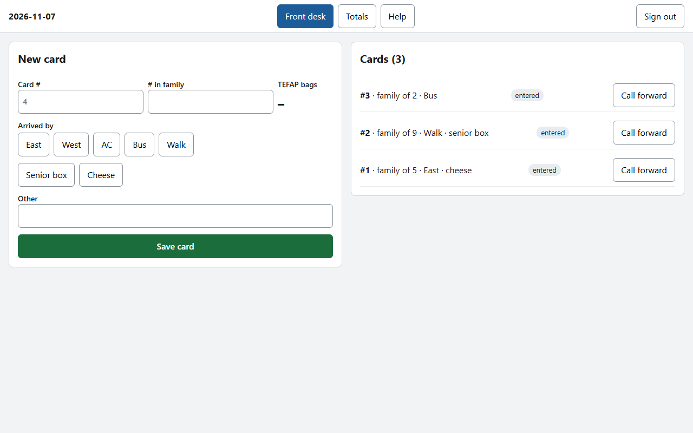
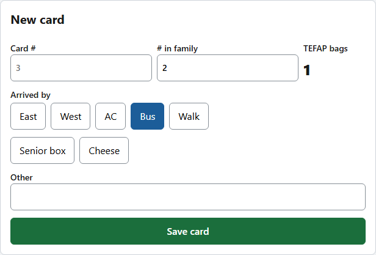
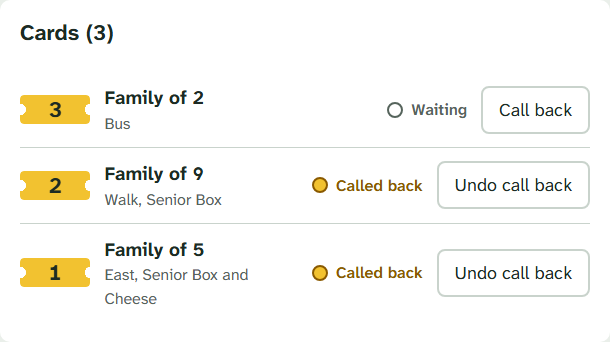

# Front desk guide
**Version 1.0.0** · Food bank shift tracker · 2026-11-08 · For front desk volunteers

---

## AI READING INSTRUCTION

Read `[SPEC]` and `[BUG]` blocks for the steps a volunteer follows and the problems they may meet.
Read `[NOTE]` only if the reason behind a step is needed.
`[?]` blocks are unverified.

---

## 1. Your screen

**[SPEC]**
- Left: the **New card** form.
- Right: the list of today's cards, newest first.

---

## 2. Entering a family

**[SPEC]**
1. **Card #**: leave it blank to use the number shown in grey, or type the number on the family's card.
2. **# in family**: type how many people are in the family.
3. **Arrived by**: tap one: East, West, AC, Bus or Walk.
4. Tap **Senior box** or **Cheese** if they apply. Tap again to undo.
5. **Other**: anything else distribution should know. Optional.
6. Tap **Save card**.

**[SPEC]**
- TEFAP bags are worked out for you from the family size:

| People in family | TEFAP bags |
|---|---|
| 1 to 4 | 1 |
| 5 to 8 | 2 |
| 9 or more | 3 |

**[NOTE]**
The form clears as soon as you tap **Save card**, so you can start the next family straight away, even before the last card has finished saving.

**[BUG] Nothing happens when you tap Save card**
Symptom: The card is not saved, and a message asks how the family arrived.
Cause: No arrival method was chosen.
Fix: Tap East, West, AC, Bus or Walk, then **Save card** again.

**[BUG] A card was not saved because its number is already in use**
Symptom: A red message says the card was not saved because the number is already in use. The family's details are back in the form.
Cause: That card number was already entered today.
Fix: Check the number on the family's card. Type the right number in **Card #**, then **Save card**.

---

## 3. Calling a family forward

**[SPEC]**
- When it is the family's turn, tap **Call forward** on their card.
- The card goes to the distribution queue straight away.
- Tapped it by mistake? Tap **Undo call**.

**[SPEC]**
Each card shows where it is:

| Label | Meaning |
|---|---|
| entered | Saved, not yet called forward |
| called | Sent to distribution |
| confirmed | Distribution has the family |
| distributed | Food given out |
| left without food | The family left before being served |

**[NOTE]**
A card marked **waiting to send** has no **Call forward** button yet. It gets one once the connection returns and the card reaches the server.

---

## 4. Changes from distribution

**[SPEC]**
- If distribution corrects a card, for example the family size, your list updates by itself.
- If you and distribution change the same card at the same moment, a message asks you to check it. Look at the card again, then make your change.

---

## 5. Totals

**[SPEC]**
- Tap **Totals** at the top to see the shift totals at any time.
- They update live. There is no page footer to add up.
