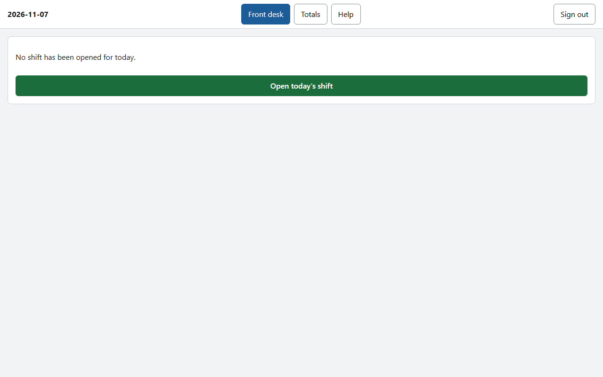
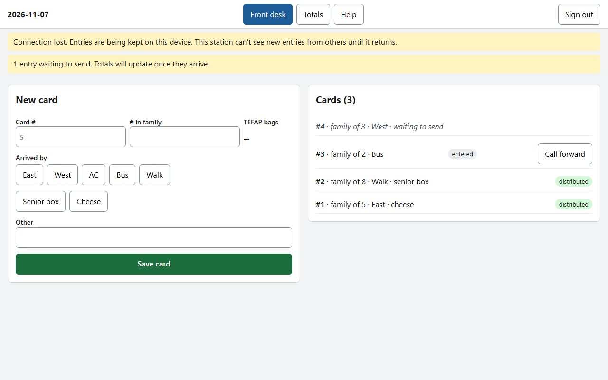

# Getting started
**Version 1.0.0** · Food bank shift tracker · 2026-11-08 · For volunteers and staff

---

## AI READING INSTRUCTION

Read `[SPEC]` and `[BUG]` blocks for the steps a volunteer follows and the problems they may meet.
Read `[NOTE]` only if the reason behind a step is needed.
`[?]` blocks are unverified.

---

## 1. What the app does

**[SPEC]**
- The app replaces the two paper sheets: the front desk sheet and the distribution sheet.
- Each station uses its own device: one at the front desk, one at distribution.
- A family's details are entered once, at the front desk. Distribution sees them straight away.
- Totals for the shift are worked out for you. Nobody adds up pages by hand.

**[NOTE]**
Card numbers are tickets for the day only. The app never records a family's name or address.

---

## 2. Opening the app

**[SPEC]**
- Open the app from its icon on the station's home screen or desktop.
- If there is no icon, open the web address the staff gave you, then use the browser's **Install** or **Add to Home Screen** option to add one.

**[NOTE]**
Station devices are set up once by staff. You will not usually need to do this.

---

## 3. Signing in

**[SPEC]**
- Each station has its own sign-in: one for the front desk and one for distribution.
- Type the station's username and password, then tap **Sign in**.
- Station devices stay signed in for weeks. You will rarely see this screen.
- Staff have their own sign-in, which lasts 12 hours.

**[NOTE]**
Keep the station passwords to yourselves. If a password is shared outside the food bank, ask staff to change it. Changing it signs that station out everywhere.

**[BUG] The sign-in screen appears in the middle of a shift**
Symptom: The station shows the sign-in screen instead of the cards.
Cause: Staff changed that station's password, or the sign-in expired.
Fix: Ask staff for the current password and sign in again. Anything typed while signed out is kept on the device and sent once you sign in.

---

## 4. Starting the shift

**[SPEC]**
- The first station to start opens today's shift. Tap **Open today's shift**.
- There is one shift per day. The other station sees it open by itself.

---

## 5. Finding your way around

**[SPEC]**
- The date is at the top left.
- The buttons at the top switch between your station's screen, **Totals** and **Help**.
- **Sign out** is at the top right. Only sign out on a personal device. Leave station devices signed in.

---

## 6. If the Wi-Fi drops

**[SPEC]**
- A yellow message says **Connection lost**.
- Keep working. Entries are kept on the device and marked **waiting to send**.
- When the connection returns, waiting entries are sent by themselves, in order.
- While disconnected, a station cannot see new entries from the other station.

**[NOTE]**
Opening or closing a shift, and signing out, need a connection. The app tells you if you try one of them during a dropout.

**[BUG] The connection is down for a long time**
Symptom: **Connection lost** stays on screen for more than a few minutes.
Cause: The Wi-Fi or the server is down.
Fix: Tell staff. If they say so, switch to the paper sheets for the rest of the shift. Staff will enter them later.

---

## 7. Getting help

**[SPEC]**
- Tap **Help** at the top of the screen to read the guide for your station.
- The guides work without a connection.
- For anything the guides don't cover, ask the staff member on duty.
